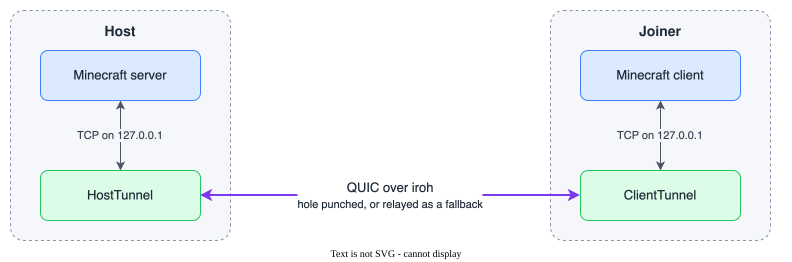
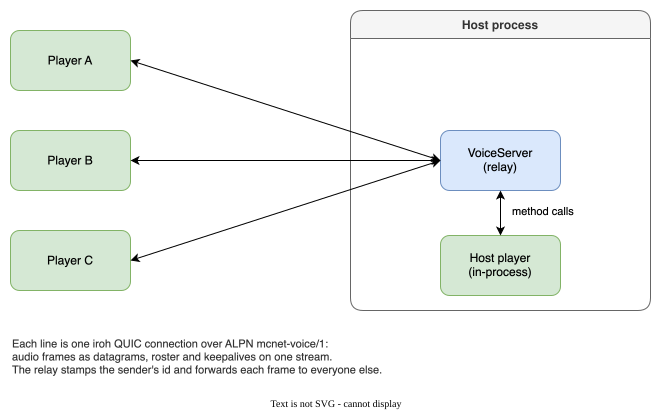

# MCNet

Peer-to-peer multiplayer for Fabric, built on [iroh](https://iroh.computer)'s
Kotlin bindings. Friends join a host by pasting a code. There is no port
forwarding, no dedicated server and no third-party proxy.

Written in Kotlin end to end, using Fabric's `kotlin` language adapter.

| Dependency | Version |
|---|---|
| Minecraft | 26.3 |
| Fabric Loader | 0.19.5 |
| Fabric API | 0.163.0 |
| iroh | iroh-ffi 1.1.0, patched at build time for the Mainline DHT (see [`dht/`](dht/)) |
| fabric-language-kotlin | 1.14.2 (Kotlin 2.4.21) |
| opus4j (voice addon only) | `de.maxhenkel.opus4j:opus4j:2.1.3` |
| libaom and dav1d (voice addon only) | v3.15.2 and 1.5.4, vendored as submodules under `video/vendor/` |

The repository builds two jars: `mcnet`, the networking mod, and `mcnet-voice`,
an optional [voice chat and camera addon](#voice-chat-and-cameras-the-optional-addon)
that depends on it.

## How it works

MCNet does not touch Minecraft's networking code. It moves bytes underneath it.



- The **host** opens the world to LAN (or is already a dedicated server), then
  accepts iroh connections and splices each QUIC stream onto a loopback TCP
  connection to the Minecraft server.
- The **joiner** binds an ephemeral loopback port and hands Minecraft that
  address. The vanilla client thinks it made an ordinary direct connection.

Because the tunnel is protocol-agnostic, it does not care what the Minecraft
packets contain. That is what keeps it robust across game updates.

NAT traversal, hole punching and relay fallback all come from iroh itself.

The diagram is a draw.io file with the source embedded, so opening
`docs/how-it-works.drawio.svg` in draw.io makes it editable again.

## Using it

**Hosting a singleplayer world:** open the pause menu, click *Host with MCNet*
in the top-left corner, then *Start hosting*. Share the join code shown.

**Hosting a dedicated server:** run `/mcnet host` (requires admin permission).
`/mcnet status` and `/mcnet stop` do what you would expect. Set
`autoHost: true` in `config/mcnet.json` to start hosting on boot.

**Joining:** on the Multiplayer screen, click *Join via MCNet*, then pick a
saved world or click *Add* to join by code. Worlds you have joined are saved to
`config/mcnet-peers.json` and shown with live status (Online, Offline or
Checking). Double-click a row to join, as in the vanilla server list.

The list is a real `ObjectSelectionList` inside a `HeaderAndFooterLayout`, the
same construction the vanilla multiplayer screen uses. Scrolling, keyboard
navigation, narration and selection all behave natively.

Status comes from a real iroh connection over a separate `mcnet-probe/1` ALPN,
so refreshing the list does not show up on the host as players joining and
leaving. It reports reachability only. MOTD and player counts would mean
speaking the Minecraft status protocol, which is exactly the knowledge MCNet
avoids in order to survive game updates.

### Two forms of join code

| Form | Looks like | Trade-off |
|---|---|---|
| **Endpoint id** | a short public key | Permanent. Survives the host changing network, so a saved entry keeps working. Needs address lookup to resolve. |
| **Ticket** | a long base32 blob | Self-contained: carries the relay and direct addresses, so it resolves with no lookup at all. Goes stale if the host's relay changes. |

Either can be pasted into the join box, and `CompositeLookup` picks the right
one.

> The join code is the only credential. Anyone holding it can connect, subject
> to the server's own whitelist and online-mode settings. Share it like a party
> invite.

## The address-lookup seam

Resolving an endpoint id to a reachable address is isolated behind
[`AddressLookup`](src/main/kotlin/dev/mcnet/net/AddressLookup.kt) and
[`MainlineDht`](src/main/kotlin/dev/mcnet/net/MainlineDht.kt). There are two
backends:

| `addressLookup` | Resolver | Needs |
|---|---|---|
| `n0` (default) | n0's DNS servers | nothing |
| `dht` | pkarr records on the BitTorrent Mainline DHT | the patched bindings from [`dht/`](dht/), which release jars include |

The DHT removes the dependency on n0's infrastructure. Records are signed by the
endpoint's own key, so no one can forge an address for a key they do not hold.

The published iroh bindings cannot reach the DHT, so the build patches them.
[`dht/build.sh`](dht/build.sh) clones upstream iroh-ffi into a temporary
directory, applies a patch of about 80 lines, builds the native library and
generates the Kotlin bindings, which are then compiled into the mod. There is
no fork. See [dht/README.md](dht/README.md) for the details.

`DhtAddressLookup` is reached reflectively, so the same source also builds
against the published bindings, which is what happens without cargo. Setting
`addressLookup=dht` on such a jar logs a warning and falls back to `n0` rather
than failing to start.

## Voice chat and cameras, the optional addon

`mcnet-voice` is a second mod in [`voice/`](voice/). It carries voice and
webcams over the same iroh endpoint as the game, so it inherits everything the
core already solved: no port forwarding, no voice server to rent, hole
punching and relay fallback included. Install it next to `mcnet` on the host
and on every player who wants to talk or be seen. Players without it keep
playing; they just cannot hear, be heard, or see anyone's camera.

Voice is proximity based: a voice carries 48 blocks by default and fades with
distance, placed in space where the speaker stands, and nobody in another
dimension hears it. The host can change the range or turn proximity off, in
which case everyone in the world hears everyone else. Cameras are not subject
to range yet: every camera that is on is shown to everyone who has cameras
enabled.

### Using it

Nothing to configure. When the host is hosting over MCNet and a player joins
with the addon installed, the server offers voice and the client connects.
That includes the host's own player on a singleplayer world, and it includes
players who joined over plain LAN rather than through a join code.

The host has two settings of its own in `config/mcnet-voice-server.json`,
read by whoever runs the relay, which is the dedicated server or the client
hosting a singleplayer world:

| Setting | Default | Does |
|---|---|---|
| `proximity` | `true` | Whether voices fade with distance at all |
| `range` | `48` | How far a voice carries, in blocks, from 1 to 512 |

Range is enforced by the host and announced to everyone who joins, so a
joiner's own config has no say in how far voices carry on someone else's
world. The settings screen shows the range of the world you are in.

| Key | Default | Does |
|---|---|---|
| Push to talk | V | Opens the microphone while held |
| Mute microphone | M | Toggles the mic off entirely |
| Toggle camera | unbound | Turns your webcam on or off for this session |
| Voice settings | unbound | Opens the settings screen |

The settings screen is also reachable from the *Voice* button on the pause
menu. It offers push-to-talk or voice activation with a live level meter for
tuning the threshold, microphone and output device selection, microphone gain,
voice volume, a HUD toggle, and a per-player list with mute, volume and a
camera toggle. Those per-player settings are keyed by player UUID and survive
across sessions. Everything lives in `config/mcnet-voice.json`.

The camera row of the same screen has the on/off switch, the device, the
quality (240p at 200 kbps up to 720p at 1500 kbps, with the width following
the camera's aspect ratio), whether other players' cameras are shown at all,
and how wide the tiles are. The on/off switch is the one setting that is not
saved: a camera never comes on by itself when a session starts, and the key
binding is unbound by default so it cannot come on from a stray keypress
either.

Cameras appear as tiles along the top-right edge, your own first and mirrored
the way a mirror would show you, each labeled with the player's name and
framed in green while that player is speaking. The voice HUD stays in the
bottom-right corner: the names of whoever is speaking, plus your own state
when it matters (talking, muted, or disconnected).

On macOS the first time you turn the camera on, the system asks for
permission in the name of your launcher. Prism Launcher declares camera use
and the prompt appears; a launcher that does not declare it would be killed by
macOS instead, so if the game vanishes at that moment, that is why.

### How it works

The design is a star. Every client holds one QUIC connection to the host over
a dedicated `mcnet-voice/3` ALPN, and the host relays each frame to everyone
else in earshot. A mesh would avoid the hop through the host, but the star is
what makes proximity cheap and trustworthy: the server is the one place that
knows every player's position, so proximity is a filter in the relay loop,
and no client can hear a voice the host did not forward to it.

Every server tick copies each player's eye position and dimension into a
snapshot the relay reads from its network threads. A frame is forwarded to a
participant only if they are in the speaker's dimension and within the range
plus ten percent. The margin is there because clients place voices from their
own view of where players are, which lags the server's by a little, and so
that the cut happens where the client's own falloff has already reached
silence. A participant whose position is not in the snapshot yet, because
they are still loading in, hears everyone until it is.



Like the other diagram, this one is a draw.io file with the source embedded,
so opening `docs/voice-topology.drawio.svg` in draw.io makes it editable.

Audio travels in QUIC **datagrams**, not streams. A voice frame that arrives
late is worthless, and a reliable stream would hold every later frame hostage
to a retransmission. Datagrams are still encrypted and authenticated by QUIC;
they just are not retransmitted. Each one is:

```
u8 type | u16 speaker | u32 sequence | opus payload
```

Opus runs at 48 kHz mono in 20 ms frames, about 60 to 80 bytes each, against
the 1162-byte datagram floor that `DatagramProbeTest` measured. The receiver
keeps a small jitter buffer per speaker (40 ms before playback starts, 60 ms
queued) and asks the decoder to conceal single lost frames. Playback goes
through the OpenAL that Minecraft already ships, on a separate context bound to
the voice thread with `ALC_EXT_thread_local_context`, so the game's own sound
engine never notices. Capture uses OpenAL too.

Each voice is an OpenAL source placed where its speaker stands, so OpenAL
does the panning and the attenuation. The client needs no positions from the
voice connection for that: the game already tracks every nearby player, and
once a frame the session records where the camera and each participant are
for the audio thread to read. The listener stays at the origin and sources
are placed at their offset from it, because OpenAL works in single precision
and Minecraft coordinates run into the millions. The falloff is linear, at
full volume within four blocks and reaching silence exactly at the announced
range, which is just inside where the relay stops forwarding. A speaker the
game has no position for, or a world without proximity, plays as plain mono.

Control traffic, which does need to arrive in order, uses one bidirectional
stream per connection: the host's settings (currently just the range) and the
participant roster, and keepalive pings so a silent listener is not dropped
for idling.

**Identity.** A voice connection is admitted only if the game session has
vouched for its endpoint id. The server sends an offer containing a ticket and
a random nonce as a Fabric custom payload; the client signs the nonce with its
iroh key and replies with its endpoint id; the server verifies the signature
against that id before binding it to the player. The QUIC handshake has already
proven the dialer holds the same key. So the join code stays the only
credential, and nobody can speak under another player's name.

The host's own player cannot dial their own endpoint, so on a singleplayer
world the host's client attaches to the relay in-process instead. On a
dedicated server that path is simply never used.

### How video works

Video rides the same connection as voice, so one congestion controller sees
both and audio is never squeezed out by video from a separate connection.
Where audio is datagrams, video is **unidirectional QUIC streams, one per
group of pictures**: a keyframe plus every frame that depends on it. An AV1
frame at webcam bitrates is two to six datagrams, and a lost one would corrupt
every frame until the next keyframe, so the reliability of a stream is wanted
here. What makes it low latency anyway is that a group is self-contained. A
sender ends each group before beginning the next, so on a healthy link every
stream finishes and every frame arrives. When a group is still being written
as the next one begins, it is cut off at once: its stream is reset and those
late frames are never delivered. Each group is written by its own coroutine,
and cancelling that coroutine drops the native write even while it waits on
flow control, so a stalled group never holds up the next one. A slow link
skips groups and never falls further behind than one.

Each stream starts with the sender's id and group number, then frames, each
prefixed by its length and a keyframe flag.

Because every group is its own stream and streams are read concurrently, the
next group's start routinely arrives before the last frames of the one before
it. Both the relay and every viewer run what they read through a small
sequencer that holds the newer group back until the older one has ended. A
group that stalls instead of ending is given up after about a second of the
newer group piling up, so the hold never costs more than that.

Control messages (roster, camera on or off, watch requests) go out through one
writer per connection, strictly in the order they were sent. Turning a camera
off and straight back on can therefore never arrive the wrong way round.

The relay forwards a camera only to participants who sent a `WATCH` for it.
A client without the native video library never asks, so it costs the host no
bandwidth; the same goes for a player who turned cameras off or hid one. The
host also keeps each sender's current group in memory, and when someone starts
watching mid-group it replays the group from its keyframe, so a new viewer
sees a picture at once instead of waiting up to three seconds for the next
keyframe. Groups are three seconds long for the same reason: nothing waits on
keyframes except recovery from a skipped group.

On the sending side, if the transport cannot take a frame the rest of that
group is dropped, the bitrate comes down by a quarter, and a new group is
started at a keyframe. Each of those happens at most once a second, so a link
that stays stalled does not turn the stream into nothing but keyframes. After
five quiet seconds the bitrate steps back up towards the configured target.
The host does the equivalent per viewer: when a group falls a whole queue
behind on one viewer's link, it is cut off for that viewer only, and
forwarding resumes at the sender's next keyframe.

The camera is announced to the others only once it has actually opened, so
nobody watches a camera stuck behind a permission prompt. If it fails or dies
later, the session turns it off, tells the host, and shows the reason in the
settings screen. Changing the camera or its quality while it is on waits for
the old capture to release the device before opening it again, since most
drivers refuse a second open, and group numbers carry on across the restart
so viewers never mistake the new stream for an old one.

On the receiving side one thread decodes every camera, writes RGBA straight
into off-heap memory, and the render thread copies that into a
`DynamicTexture` and uploads it. Raw pixels never touch the Java heap and the
render thread never waits on a decode. A viewer that falls seconds behind
skips to the next keyframe, as the relay would for it. Only cameras the
viewer asked the host for are decoded; frames still in flight for someone who
left or was hidden are dropped rather than starting a decoder up again. The
incoming queue is bounded, and a decoding failure costs only that one camera
its current group, never the decode thread.

### The native video library

Capture and codecs live in a Rust crate under [`video/`](video/), exposed to
Kotlin through [UniFFI](https://mozilla.github.io/uniffi-rs/), the same
binding generator iroh uses. Raw frames never cross into the JVM: the camera
hands out opaque frame handles, the encoder turns them into packets, and the
decoder writes decoded pictures to wherever the JVM points it. The only bytes
copied across the boundary are the encoded packets, which the network carries
anyway.

| Part | What it is |
|---|---|
| Capture, macOS | AVFoundation through the [objc2](https://github.com/madsmtm/objc2) bindings. AVFoundation scales and converts to NV12 itself. |
| Capture, Windows | Media Foundation's source reader through Microsoft's `windows` crate, with video processing on so the camera's MJPEG or YUY2 arrives as NV12. |
| Capture, Linux | Video4Linux2 through the `v4l` crate, with NV12, YUYV and MJPEG (decoded by `zune-jpeg`) accepted. |
| Encoder | [libaom](https://aomedia.googlesource.com/aom/) in realtime mode, set up like WebRTC's AV1 encoder: constant bitrate, no lookahead, the slow tools off. Built encoder-only and realtime-only. |
| Decoder | [dav1d](https://code.videolan.org/videolan/dav1d), 8-bit only, one frame of delay. |

libaom (v3.15.2) and dav1d (1.5.4) are pinned as git submodules under
`video/vendor/` and linked statically, so the finished library depends on
nothing but the OS. No cross-platform capture crate was used on purpose: the
obvious one could not open OBS Virtual Camera and is built on bindings the
Rust compiler already warns will stop compiling, and each OS backend is only a
few hundred lines over the platform's own API.

The voice jar bundles one library per platform under the folder names JNA
looks in (`darwin-aarch64/`, `linux-x86-64/`, `linux-aarch64/`,
`win32-x86-64/`), each built on its own platform by CI. The Kotlin bindings
are generated from the built library and committed under
`voice/src/client/generated/`, so compiling the addon never needs Rust. They
carry a checksum of the API they came from and refuse a library that does not
match, which turns a stale commit into a clear error rather than a crash.
Where the library is missing or fails to load, voice works and the settings
screen says that video is unavailable.

Measured on an Apple M4 at 640x360, 30 fps, 400 kbps, libaom speed 10, two
threads, with clips that have camera-like grain: about 415 kbps actual, 5 KB
keyframes, 1.6 KB other frames, encode under 4.5 ms at the 95th percentile and
decode under 1.3 ms. Encoding one camera takes about an eighth of a frame
interval, and each camera a viewer watches costs about a millisecond of decode
per frame.

### The addon seam

Voice is built on two small additions to the core that any other addon can use:

| API | What it does |
|---|---|
| [`Protocols.register(alpn, handler)`](src/main/kotlin/dev/mcnet/net/Protocols.kt) | Advertises an ALPN on the shared endpoint and routes connections carrying it to the handler. Call it from a mod initializer; a late call still updates the live endpoint. Connections are only accepted while hosting. |
| [`MCNetEvents`](src/main/kotlin/dev/mcnet/MCNetEvents.kt) | `HOSTING_STARTED`, `HOSTING_STOPPED`, `PEER_CONNECTED`, `PEER_DISCONNECTED`, on the host. All fire off the server thread. |
| [`MCNetClientEvents`](src/client/kotlin/dev/mcnet/client/MCNetClientEvents.kt) | `JOINED` and `LEFT`, on the client, on the render thread. |

`HostTunnel` also exposes `peers`, the endpoint ids currently tunneled into the
game, for addons that want to gate on it.

## Building

```sh
./gradlew build          # lint, test and package both jars
./gradlew test           # end-to-end tunnel and relay tests
./gradlew spotlessApply  # format the code
./gradlew runClient      # dev client with the core mod only
./gradlew :voice:runClient  # dev client with the core and the voice addon
```

The core jar lands in `build/libs/` and the addon in `voice/build/libs/`.
Gradle provisions the JDK 25 toolchain automatically.

When `cargo` is on the PATH, the core build runs
[`dht/build.sh`](dht/build.sh) to clone, patch and build iroh-ffi with DHT
support. That needs git and bash too, and the first run takes several minutes.
The resulting jar only carries iroh's native library for the machine that
built it, so it runs nowhere else. Without cargo, or with `-Pmcnet.dht=false`,
the core uses the published iroh bindings instead: natives for every platform,
but no DHT. CI builds the patched library on every platform and passes the set
in with `-Pmcnet.iroh=<dir>`.

The addon's native video library is built from [`video/`](video/) the same
way, when `cargo` is on the PATH, for the machine doing the building. That
needs the codec submodules and the tools pinned in `.mise.toml`, plus nasm on
x86_64:

```sh
git submodule update --init
mise install            # cmake, meson, ninja
./gradlew :voice:build  # builds video/ with cargo and bundles the library
```

Without cargo the jar is built without the library and video is unavailable
in it; `-Pmcnet.video=false` does the same on purpose. CI instead builds the
library on every platform and passes the set in with
`-Pmcnet.videoNatives=<dir>`. After changing the crate's public API, run
`./gradlew :voice:generateVideoBindings` and commit the result. The Windows
and Linux capture backends can be type-checked from any machine with
`MCNET_VIDEO_BINDINGS_ONLY=1 cargo check --target <triple>` in `video/`.

The voice subproject compiles against the core's source set outputs rather
than its jar (the jar has iroh nested inside, which the loader would try to
load twice in dev), and lists the core's source sets in its own `loom.mods`
block, which is what lets its dev client see MCNet as a mod rather than as
loose classes.

### Signing in to the dev client

The Gradle dev client is its own Minecraft install. It knows nothing about
the accounts in your launcher and starts as an offline player with a name
like `Player392` and a throwaway access token. That is fine for a
singleplayer world, but joining a hosted world fails with "Invalid session":
the host's integrated server always verifies joiners against Mojang's
session servers, and the offline player has nothing to verify.

Both dev runs include [DevAuth](https://github.com/DJtheRedstoner/DevAuth),
a dev-only mod that signs the client in to a real Microsoft account. It is a
runtime-only dependency, so it never ends up in a built jar. Pass the name of
a DevAuth account to turn it on:

```sh
./gradlew :voice:runClient -Pmcnet.account=main
```

The first run prints a `login.live.com` URL in the Gradle output. Open it in
a browser, sign in, and the game continues once the browser lands on the
local redirect. The token is cached in `~/.devauth` (or
`$XDG_CONFIG_HOME/devauth` on Linux), so later runs sign in silently. The
generated `~/.devauth/config.toml` defines two accounts, `main` and `alt`,
and you can add more.

Testing a join needs two different accounts, because the integrated server
treats a second login with the host's own account as the host reconnecting
and kicks the first one. Sign one client in as `main` and the other as `alt`,
or host from your normal launcher and join from a dev client signed in to a
different account.

### Linting and formatting

Kotlin sources and the Gradle build scripts are linted and formatted by
[ktlint](https://pinterest.github.io/ktlint/), run through
[Spotless](https://github.com/diffplug/spotless). `./gradlew build` runs
`spotlessCheck` as part of `check`, so CI fails on code that is not formatted.
Run `./gradlew spotlessApply` to fix it. Style settings live in
[`.editorconfig`](.editorconfig), which IntelliJ reads too.

### The Gradle wrapper

`gradle/wrapper/gradle-wrapper.jar` is committed, as the wrapper requires. It is
also an executable binary and therefore a supply-chain target. Two checks guard
it: `distributionSha256Sum` in `gradle-wrapper.properties` pins the Gradle
distribution, and CI runs `gradle/actions/wrapper-validation` against the
checksums Gradle publishes for official releases. The committed jar matches
Gradle 9.8.1 (SHA-256 `3b8a2577` through `8e98`).

The built jar carries the iroh bindings and their native libraries (about
29 MB), so users install a single file. Patched bindings are compiled straight
into it; the published ones, when used, are nested via Jar-in-Jar, as is JNA.
The voice jar nests opus4j the same way (about 1.5 MB with natives for six
platforms) and deliberately does not carry iroh or JNA again, since Fabric
loads every mod on one classpath and the core already provides them.

### Releasing

Publish a GitHub release tagged `v1.2.3` and
[`.github/workflows/release.yml`](.github/workflows/release.yml) builds the
patched iroh library and the native video library on macOS, Linux (x86_64 and
aarch64) and Windows runners, then builds both mods with those libraries
bundled and attaches the jars to it. The tag drives the version: `v1.2.3` is
stamped into both `fabric.mod.json` files via `-Pmod_version`, so the release
and the mod metadata cannot disagree. The core and the addon are versioned
together; the addon declares the core version it was built against.

The attached jars carry no version in their names (`mcnet.jar`,
`mcnet-voice.jar`, plus their `-sources` jars), so these links always
download the newest release:

- https://github.com/playforge-coding/MCNet/releases/latest/download/mcnet.jar
- https://github.com/playforge-coding/MCNet/releases/latest/download/mcnet-voice.jar

Before publishing, the workflow checks that each jar is actually usable: the
DHT-capable iroh bindings with all four iroh libraries, plus JNA, must be inside
the core, opus4j and all four video libraries inside the addon, and the version
must be stamped. A Jar-in-Jar failure still produces a jar that builds fine and
then dies with `NoClassDefFoundError` the first time someone hosts, so it is
worth catching before it reaches a download button.

`workflow_dispatch` runs the same build without a release, leaving the jar as a
workflow artifact.

Both workflows cache the native libraries. The video ones are keyed on the git
tree of `video/` (which pins the aom and dav1d submodule commits) and the rustc
version; the iroh ones on `iroh_version`, the git tree of `dht/` and the rustc
version. Releasing a commit that already built on main reuses those libraries
instead of rebuilding them, which skips the slowest part of the run. Caches
saved by pull requests are visible only to that pull request, so a release
never picks up a library built from a fork.

### Tests

The tests cover what cannot be verified by reading source.

`TunnelTest` runs two real iroh endpoints against a loopback echo server:

- the native library loads and an endpoint binds
- bytes survive a full round trip through the tunnel
- a finished QUIC stream surfaces as an **empty read**, which is the condition
  `bridge()` uses to detect end-of-stream

`DatagramProbeTest` records the iroh datagram budget, which decides whether
Bedrock/RakNet could be tunneled. It is **not fixed**: measured at 1162 bytes
early in a connection and 1288 once path-MTU discovery settles, so RakNet's
1200-byte tier cannot be assumed to fit.

`ProbeAlpnTest` covers the peer list's liveness check. A host must be able to
read a connection's ALPN *without* consuming the handshake (so probes can be
routed away from the player path), and a real join must never be mistaken for
a probe.

`MainlineDhtTest` guards the DHT hookup from both sides: a real endpoint bind
on the patched bindings, and graceful fallback on the published ones
(`-Pmcnet.dht=false`).

`ProtocolsTest` covers the addon registry: lookup by ALPN content rather than
array identity, and refusal of reserved or duplicate ALPNs.

The voice addon has its own tests under [`voice/src/test`](voice/src/test):

- `VoiceProtocolTest` and `VideoProtocolTest` pin the datagram, stream and
  control framing byte for byte. `VideoProtocolTest` also covers the
  sequencer: a group that overtakes the tail of the one before it is held
  back, a stalled group is given up, and a group two ahead replaces both.
- `OpusTest` proves the Opus native loads on the build machine and that a
  frame survives the codec, including the concealment path.
- `VideoCodecTest` does the same for the video library: it loads through JNA,
  the committed bindings match it, and frames come back out of the decoder
  as off-heap RGBA.
- `VoiceRelayTest` runs the relay against real iroh endpoints: roster
  handshake, fan-out with the sender's id stamped in, refusal of an endpoint
  no game session vouched for, and the in-process path the host's own player
  uses.
- `VideoRelayTest` does the same for video: the camera flag in the roster,
  forwarding only to watchers, a late watcher caught up from the keyframe,
  every frame of back-to-back groups arriving intact, a newer group
  superseding an unfinished one, unwatching, control messages applied in the
  order they were sent, and the in-process path.

The Rust crate's own tests (`cargo test --release` in `video/`) check that a
frame survives the AV1 round trip above 30 dB PSNR, that keyframes land on
the interval and on request, that the bitrate can change mid-stream, that
NV12 and YUYV conversion skip row padding, and that output sizes keep the
camera's aspect ratio.

Microphone capture, OpenAL playback and camera capture are not unit tested.
They need hardware, so those layers are kept thin.

## Known limitations

- **JNA comes from Minecraft.** The game already ships JNA via
  `com.github.oshi:oshi-core`. MCNet pins and bundles the same version (5.17.0)
  as a fallback so the two copies cannot skew. This is why JNA is deliberately
  not on the newest release.
- **Camera capture on Windows and Linux has not been run on hardware.** The
  Media Foundation and V4L2 backends compile against the real platform crates
  and follow the documented APIs, but only the macOS backend has been used
  with cameras so far (a Mac's built-in camera and OBS Virtual Camera).
  Decoding and watching work everywhere the library builds.
- Cameras are shown as HUD tiles only. Drawing them above players' heads in
  the world, and using distance to decide which cameras to fetch, are the
  natural next steps and the relay already supports subscribing per camera.
- Hosting a singleplayer world opens it to LAN underneath (the same thing as
  the LAN option under *World Options* in the pause menu), so it also
  broadcasts to your local network.
